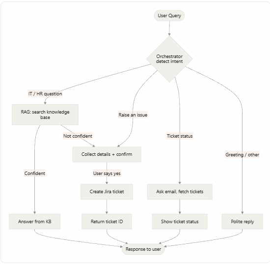

# SmartDesk 

A Smartdesk AI Agent to resolve IT/HR Employee Queries and also a tool to create Jira ticket if not in scope.

TechStack:
React
FastApi
Langraph
Rag
MCP
Langsmith

Backend (terminal 1):
    cd backend
    python -m venv .venv
    .venv\Scripts\activate
    pip install -r requirements.txt
    uvicorn main:app --reload --port 8000

Frontend (terminal 2):
    cd frontend
    npm install
    npm run dev

Open http://localhost:5173 and click Send: the reply is "Hello World".

## System Architecture

## Langraph 
[./images/langraph.png]

## KB

"syncora/hr-policies-qa-dataset", split="train"
Generated kb using llm

# Retrieval comparison  (n=50 queries)
| mode | hit@1 | hit@3 | MRR@5 | hit@3 standard | hit@3 keyword | hit@3 semantic | latency_p50_ms |
|---|---|---|---|---|---|---|---|
| dense | 0.94 | 0.98 | 0.96 | 1.0 | 0.9 | 1.0 | 60.2 |
| bm25 | 0.74 | 0.82 | 0.78 | 0.9 | 1.0 | 0.4 | 60.3 |
| hybrid | 0.92 | 1.0 | 0.96 | 1.0 | 1.0 | 1.0 | 61.1 |
| hybrid_rerank | 0.94 | 1.0 | 0.97 | 1.0 | 1.0 | 1.0 | 106.7 |

